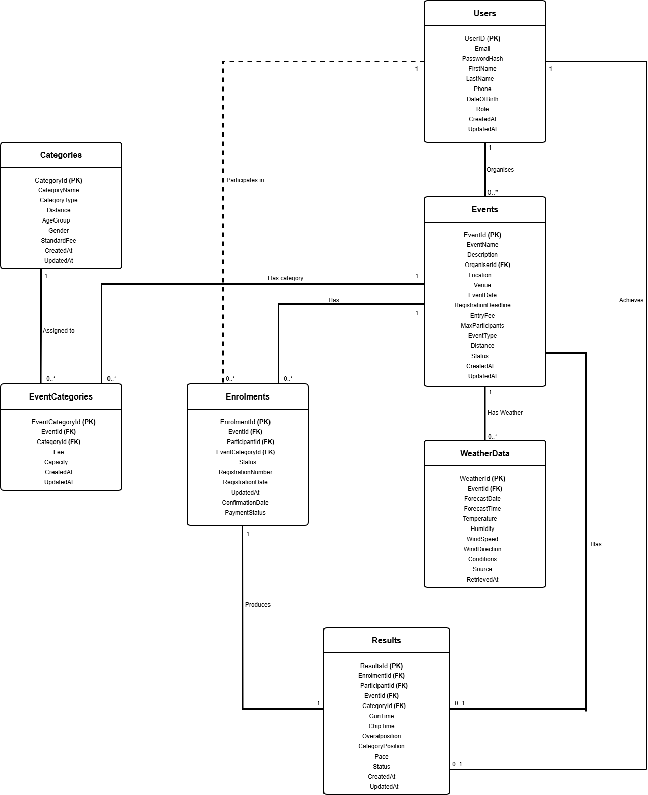

# 🏃 RaceDay Event Management System


A full-stack, API-driven event management system designed specifically for the South African road running, walking, and cycling community.

---

## 📋 Project Overview

**RaceDay** modernises the South African road events ecosystem (from the Comrades Marathon to local park runs) by providing a complete digital platform for event organisers and participants. 

This project was built progressively across three parts:
- **Part 1:** System Planning and Database Design (ERD, API plan, SQL script)
- **Part 2:** RESTful API Development (ASP.NET Core Web API)
- **Part 3:** MVC Web Application (ASP.NET Core MVC Frontend)

The application features a modern, responsive UI inspired by the Cape Town Marathon, secure session-based authentication, and local image storage.

---

## 🎯 System Roles

The system supports **two distinct user roles** with separated access:

### 🎽 Organiser
- Create, update, and cancel events
- Define age/distance categories per event
- View all enrolments for their own events
- Capture finish times and finishing positions after events conclude
- Cannot enrol in events

### 🏃 Participant
- Browse all available events
- Enrol in events by selecting a category
- View their own enrolments and enrolment status
- View personal race history across all completed events
- Upload a profile picture and update personal details
- Cannot create or manage events

Role-based access is enforced at both the **API level** and the **MVC Frontend**.

---

## 🏗️ Architecture

The system is split into two main projects that communicate via HTTP:

| Component | Technology |
|-----------|------------|
| **Backend API** | ASP.NET Core 8 Web API |
| **Frontend MVC** | ASP.NET Core 8 MVC |
| **Database** | SQL Server (LocalDB) |
| **Data Access** | ADO.NET (`System.Data.SqlClient`) with parameterised queries |
| **Authentication** | Session-based with SHA-256 password hashing |
| **API Documentation** | Swagger / OpenAPI with XML comments |
| **File Storage** | Local `wwwroot` directory (Event banners & Profile pictures) |
| **Testing** | xUnit + `Microsoft.AspNetCore.Mvc.Testing` (WebApplicationFactory) |
| **CI/CD** | GitHub Actions |

### Why ADO.NET?
Per the module requirements, this project uses **ADO.NET** for data access rather than Entity Framework Core. All database operations use `SqlConnection`, parameterised `SqlCommand` (preventing SQL injection), and `SqlDataReader`.

---

## 🗄️ Database Schema

The database `raceday_eventDB` contains **7 entities**:

1. **Users** (Organisers and Participants)
2. **Events** (Created by Organisers)
3. **Categories** (Marathon, Half Marathon, 10km, etc.)
4. **EventCategories** (Junction table linking Events to Categories)
5. **Enrolments** (Participant registrations)
6. **Results** (Race results with finish times and positions)
7. **WeatherData** (Weather forecasts for events)

### Entity Relationship Diagram


*The full SQL schema and seed data are available in [`docs/raceday_eventDB.sql`](docs/raceday_eventDB.sql).*

---

## 🚀 Setup Instructions

### Prerequisites
- [.NET 8 SDK](https://dotnet.microsoft.com/download/dotnet/8.0)
- [SQL Server 2022](https://www.microsoft.com/en-us/sql-server/sql-server-downloads) or SQL Server LocalDB
- [Visual Studio 2022](https://visualstudio.microsoft.com/)

### Step 1: Clone the Repository
```bash
git clone https://github.com/Adiwhaho2003/Raceday-Event-Management-System.git
cd Raceday-Event-Management-System
```

### Step 2: Create the Database
1. Open **SQL Server Management Studio (SSMS)**
2. Connect to your SQL Server instance (recommended: `(localdb)\api_raceday`)
3. Open `docs/raceday_eventDB.sql`
4. Press **F5** to execute

Verify the database was created:
```sql
USE raceday_eventDB;
SELECT COUNT(*) FROM Users; -- Should return 4
SELECT COUNT(*) FROM Events; -- Should return 3
```

### Step 3: Configure the Connection String
Open the files in the `Database/` folder (API) and `CustomWebApplicationFactory.cs` (Tests). Verify the connection string matches your setup:
```csharp
private string connection_string = @"Data Source=(localdb)\api_raceday;Initial Catalog=raceday_eventDB;Integrated Security=True;TrustServerCertificate=True;";
```

### Step 4: Run the API
```bash
dotnet run --project RaceDay_Management_System
```
The API starts at `https://localhost:7063`. Swagger is available at `/swagger`.

### Step 5: Run the MVC Frontend
Open a **new terminal window** (keep the API running) and run:
```bash
dotnet run --project Raceday-Event-Management-System.MVC
```
The web app starts at `https://localhost:7299`.

---

## 🧪 Running Tests

The test project contains **21 integration tests** covering authentication, event management, role enforcement, and enrolments.

```bash
dotnet test
```

**Expected output:**
```text
Passed!  - Failed: 0, Passed: 21, Skipped: 0, Total: 21, Duration: ~20s
```
> **Note:** Integration tests require a live SQL Server instance. The GitHub Actions CI pipeline runs a build verification on every push.

---

## 📡 API Endpoints

The API exposes **42 endpoints** across 7 resource areas:
- **Authentication** (6), **Users** (8), **Events** (6), **Categories** (5), **Event Categories** (4), **Enrolments** (6), **Results** (7).

**Full specification:** See [`docs/API_ENDPOINT_PLAN.pdf`](docs/API_ENDPOINT_PLAN.pdf).

---

## 🎥 Video Presentation

[**Watch the full project walkthrough here**](https://youtu.be/lYpDC1AGnEI)

**The video covers:**
- ⏱️ **0:00** — Introduction and project overview
- ⏱️ **1:00** — Code structure (API & MVC)
- ⏱️ **3:00** — Swagger walkthrough
- ⏱️ **4:00** — Authentication & Role enforcement
- ⏱️ **5:00** — Unit tests & CI/CD Pipeline
- ⏱️ **6:00** — MVC Frontend features & UI Tour

---

## 📁 Repository Structure

```text
Raceday-Event-Management-System/
│
├── RaceDay_Management_System/            # Part 2: RESTful API
│   ├── Controllers/
│   ├── Database/
│   ├── Models/
│   ├── Enums/
│   ├── Program.cs
│   └── RaceDay_Management_System.csproj
│
├── Raceday-Event-Management-System.MVC/  # Part 3: MVC Frontend
│   ├── Controllers/
│   ├── Models/
│   ├── Services/
│   ├── Views/
│   ├── wwwroot/                          # Local Image Storage
│   │   ├── css/
│   │   └── images/
│   │       ├── events/
│   │       └── profiles/
│   ├── appsettings.json
│   └── Program.cs
│
├── RaceDay_Management_System.Tests/      # xUnit Test Project
│   ├── AuthTests.cs
│   ├── EventTests.cs
│   ├── RoleEnforcementTests.cs
│   ├── EnrolmentTests.cs
│   └── CustomWebApplicationFactory.cs
│
├── docs/                                 # Part 1 Planning Documents
│   ├── ERD.png
│   ├── API_ENDPOINT_PLAN.pdf
│   ├── raceday_eventDB.sql
│   └── ci-screenshot.png
│
├── .github/workflows/ci.yml              # GitHub Actions CI/CD
└── README.md                             # This file
```

---

## 🛠️ Technologies Used

| Technology | Version | Purpose |
|------------|---------|---------|
| ASP.NET Core | 8.0 | Web API & MVC Frameworks |
| ADO.NET (`System.Data.SqlClient`) | 4.9.1 | Database access |
| SQL Server | 2022 | Relational database |
| Swashbuckle.AspNetCore | 6.6.2 | Swagger / OpenAPI |
| xUnit | 2.5.3 | Integration testing |
| BCrypt.Net-Next | 4.2.0 | Password hashing utility |
| Bootstrap 5 & Icons | 5.x | Responsive UI & Icons |
| GitHub Actions | — | CI/CD |

---

## 👨‍💻 Author

**Adivhaho Ntsengeni**  
Student Number: ST10481277  
Course: PROG6212 — Programming 2B  
Institution: Rosebank International

---

## 🏁 Project Status

| Part | Status |
|------|--------|
| Part 1 — System Planning and Database | ✅ Complete |
| Part 2 — RESTful API Development | ✅ Complete |
| Part 3 — MVC Web Application | ✅ Complete |

---

*© 2026 RaceDay Event Management System*