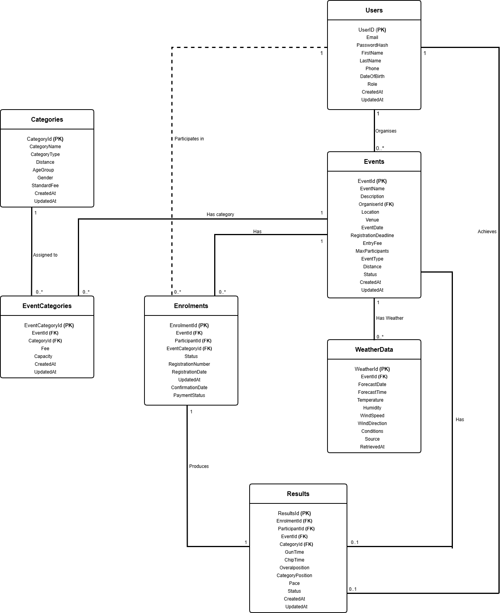
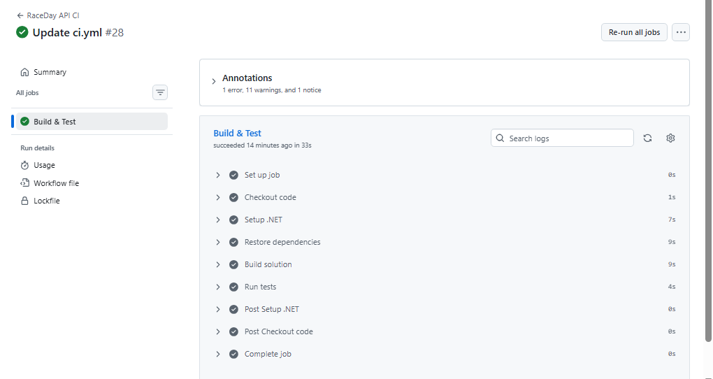

# 🏃 RaceDay Event Management System
---

## 📋 Project Overview

**RaceDay** is a full-stack, API-driven event management system designed specifically for the South African road running, walking, and cycling community.

South Africa has a rich road events culture — from the iconic **Comrades Marathon** between Pietermaritzburg and Durban, to the **Cape Town Cycle Tour**, the **Soweto Marathon**, the **Two Oceans Marathon**, and hundreds of community walks, park runs, and charity cycling events held every weekend. Despite the enormous participation these events attract, many are still managed through paper-based registration, spreadsheets, and disconnected communication channels.

RaceDay modernises this ecosystem by providing:

- A **RESTful API** for all event management operations
- **Role-based access** for Organisers and Participants
- **Session-based authentication** with secure password hashing
- **Interactive API documentation** via Swagger
- **Comprehensive integration testing** with CI/CD

This project is built progressively across three parts:

- **Part 1:** System planning and database design (ERD, API plan, SQL script)
- **Part 2:** RESTful API development (this repository)
- **Part 3:** MVC web application with Azure Blob Storage and Docker

---

## 🎯 System Roles

The system supports **two distinct user roles** with separated access:

### 🎽 Organiser

- Create, update, and delete events
- Define age/distance categories per event
- View all enrolments for their own events
- Capture finish times and finishing positions after events conclude
- Cannot enrol in events

### 🏃 Participant

- Browse all available events
- Enrol in events by selecting a category
- View their own enrolments and enrolment status
- View personal race history across all completed events
- Cannot create or manage events

Role-based access is enforced at the **API level** through session-based authentication. Every protected endpoint checks both authentication (is the user logged in?) and authorisation (does the user have the required role?).

---

## 🏗️ Architecture

| Component | Technology |
|-----------|------------|
| **Framework** | ASP.NET Core 8 Web API |
| **Database** | SQL Server (LocalDB for development) |
| **Data Access** | ADO.NET (`System.Data.SqlClient`) with parameterised queries |
| **Authentication** | Session-based with SHA-256 password hashing |
| **API Documentation** | Swagger / OpenAPI with XML comments |
| **Testing** | xUnit + `Microsoft.AspNetCore.Mvc.Testing` (WebApplicationFactory) |
| **CI/CD** | GitHub Actions |

### Why ADO.NET (not Entity Framework Core)?

Per the module requirements, this project uses **ADO.NET** for data access rather than Entity Framework Core. All database operations use:

- `SqlConnection` for database connections
- `SqlCommand` with **parameterised queries** (SQL injection protection)
- `SqlDataReader` for reading result sets
- Triple `using` statements for guaranteed resource cleanup

---

## 🗄️ Database Schema

The database `raceday_eventDB` contains **7 entities**:

| # | Table | Purpose |
|---|-------|---------|
| 1 | **Users** | Organisers and Participants |
| 2 | **Events** | Events created by Organisers |
| 3 | **Categories** | Race categories (Marathon, Half Marathon, 10km, etc.) |
| 4 | **EventCategories** | Junction table linking Events to Categories |
| 5 | **Enrolments** | Participant registrations |
| 6 | **Results** | Race results with finish times and positions |
| 7 | **WeatherData** | Weather forecasts for events |

### Entity Relationship Diagram



The full ERD is available in [`docs/ERD.png`](docs/ERD.png). The complete SQL schema and seed data are in [`docs/raceday_eventDB.sql`](docs/raceday_eventDB.sql).

---

## 🚀 Setup Instructions

### Prerequisites

- [.NET 8 SDK](https://dotnet.microsoft.com/download/dotnet/8.0)
- [SQL Server 2022](https://www.microsoft.com/en-us/sql-server/sql-server-downloads) or SQL Server LocalDB
- [Visual Studio 2022](https://visualstudio.microsoft.com/) (Community edition is fine)

### Step 1: Clone the Repository

```bash
git clone https://github.com/Adiwhaho2003/Raceday-Event-Management-System.git
cd Raceday-Event-Management-System
```

### Step 2: Create the Database

1. Open **SQL Server Management Studio (SSMS)**
2. Connect to your SQL Server instance (recommended: `(localdb)\api_raceday`)
3. Open the file `docs/raceday_eventDB.sql`
4. Press **F5** to execute

Verify the database was created:

```sql
USE raceday_eventDB;

SELECT COUNT(*) FROM Users;          -- Should return 4
SELECT COUNT(*) FROM Events;         -- Should return 3
SELECT COUNT(*) FROM Categories;     -- Should return 10
```

### Step 3: Configure the Connection String

Open each file in the `Database/` folder and verify the `connection_string` field points to your SQL Server instance:

```csharp
private string connection_string = @"Data Source=(localdb)\api_raceday;Initial Catalog=raceday_eventDB;Integrated Security=True;TrustServerCertificate=True;";
```

If your SQL Server instance has a different name, update this string in all 7 database files (`AuthDatabase.cs`, `UserDatabase.cs`, `EventDatabase.cs`, `CategoryDatabase.cs`, `EventCategoryDatabase.cs`, `EnrolmentDatabase.cs`, `ResultDatabase.cs`) and in the test project's `CustomWebApplicationFactory.cs`.

### Step 4: Build and Run

```bash
dotnet restore
dotnet build
dotnet run --project RaceDay_Management_System
```

The API starts at `https://localhost:7063`.

### Step 5: Explore the API with Swagger

Open in your browser:

```
https://localhost:7063/swagger
```

**Recommended test flow:**

1. **Register** a new account via `POST /api/auth/register` (choose role: Participant or Organiser)
2. **Login** via `POST /api/auth/login` — the session cookie is set automatically
3. Explore other endpoints — the session cookie is sent with every request

---

## 🧪 Running Tests

The test project contains **21 integration tests** across 4 test classes:

| Test Class | Tests | Coverage |
|------------|-------|----------|
| `AuthTests` | 6 | Register (success, duplicate, password mismatch), login (valid, invalid, unregistered) |
| `EventTests` | 5 | Create event (Organiser success, Participant 403, unauthenticated 401), get all, invalid type |
| `RoleEnforcementTests` | 7 | Users list access, category delete, own-enrolments enforcement, public endpoints |
| `EnrolmentTests` | 3 | Participant enrol, Organiser 403, unauthenticated 401 |

### Run Locally

```bash
dotnet test
```

**Expected output:**

```
Passed!  - Failed: 0, Passed: 21, Skipped: 0, Total: 21, Duration: ~20s
```

> **Note on CI:** The integration tests require a live SQL Server instance. GitHub Actions runs a **build verification** on every push. All 21 tests pass locally.

---

## 📡 API Endpoints

The API exposes **42 endpoints** across 7 resource areas:

| Resource Area | Endpoints | Description |
|---------------|-----------|-------------|
| **Authentication** | 6 | Register, login, logout, view/update profile, change password |
| **Users** | 8 | User profile, events by organiser, enrolments, results, profile picture |
| **Events** | 6 | Event CRUD operations with role-based access |
| **Categories** | 5 | Category management (Running, Walking, Cycling) |
| **Event Categories** | 4 | Link categories to events with fee/capacity overrides |
| **Enrolments** | 6 | Participant registrations and status management |
| **Results** | 7 | Race results and leaderboards |

### Key Endpoint Examples

| Method | Route | Role Required | Description |
|--------|-------|---------------|-------------|
| POST | `/api/auth/register` | None | Register a new user (Participant or Organiser) |
| POST | `/api/auth/login` | None | Authenticate and establish session |
| GET | `/api/events` | None | Browse all events |
| POST | `/api/events` | Organiser | Create a new event |
| GET | `/api/events/{eventId}/categories` | None | View categories for an event |
| POST | `/api/enrolments` | Participant | Enrol in an event by selecting a category |
| GET | `/api/results/event/{eventId}/leaderboard` | None | View event leaderboard |

**Full specification:** See [`docs/API_ENDPOINT_PLAN.pdf`](docs/API_ENDPOINT_PLAN.pdf).

### Interactive Testing

All endpoints are documented and testable through **Swagger UI** at `https://localhost:7063/swagger`. Each endpoint includes:

- Description of its purpose
- Required parameters with types
- Expected response codes (200, 201, 400, 401, 403, 404, 409)
- "Try it out" functionality

---

## 🚦 CI/CD Pipeline

The project uses **GitHub Actions** for continuous integration. Every push to `main` or `develop` (and every pull request to `main`) triggers the workflow in [`.github/workflows/ci.yml`](.github/workflows/ci.yml):

1. ✅ Checkout code
2. ✅ Setup .NET 8 SDK
3. ✅ Restore NuGet dependencies
4. ✅ Build solution in Release mode

### Green Build Screenshot



View the latest workflow runs: [GitHub Actions](https://github.com/Adiwhaho2003/Raceday-Event-Management-System/actions)

---

## 🎥 Video Presentation

[**Link:** ](https://youtu.be/lYpDC1AGnEI)https://youtu.be/lYpDC1AGnEI

---
**The video covers:**

- ⏱️ **1:00** — Introduction and project overview
- ⏱️ **2:00** — Code structure (Controllers, Databases, Models, Enums)
- ⏱️ **3:00** — Swagger walkthrough (all endpoint groups)
- ⏱️ **3:30** — Authentication flow and role enforcement demo
- ⏱️ **4:00** — Unit tests in Test Explorer (21 passing)
- ⏱️ **5:00** — CI/CD green build demonstration
- ⏱️ **5:30** — Summary and closing

---

## 📁 Repository Structure

```
Raceday-Event-Management-System/
│
├── Controllers/                          # API endpoints
│   ├── AuthController.cs                 # Register, login, logout, profile
│   ├── UsersController.cs                # User profile and related data
│   ├── EventsController.cs               # Event CRUD
│   ├── CategoriesController.cs           # Category management
│   ├── EventCategoryController.cs        # Event-category linking
│   ├── EnrolmentsController.cs           # Participant enrolments
│   └── ResultsController.cs              # Race results
│
├── Database/                             # ADO.NET data access layer
│   ├── AuthDatabase.cs
│   ├── UserDatabase.cs
│   ├── EventDatabase.cs
│   ├── CategoryDatabase.cs
│   ├── EventCategoryDatabase.cs
│   ├── EnrolmentDatabase.cs
│   └── ResultDatabase.cs
│
├── Enums/
│   └── UserRole.cs                       # UserRole enum (Participant, Organiser)
│
├── Models/                               # C# entity classes
│   ├── User.cs
│   ├── Event.cs
│   ├── Category.cs
│   ├── EventCategory.cs
│   ├── Enrolment.cs
│   ├── Result.cs
│   └── WeatherData.cs
│
├── docs/                                 # Part 1 planning documents + CI screenshot
│   ├── ERD.png                           # Entity Relationship Diagram
│   ├── API_ENDPOINT_PLAN.pdf             # Complete endpoint specification
│   ├── raceday_eventDB.sql               # Database schema + seed data
│   └── ci-screenshot.png                 # GitHub Actions green build
│
├── RaceDay_Management_System.Tests/      # xUnit test project
│   ├── AuthTests.cs
│   ├── EventTests.cs
│   ├── RoleEnforcementTests.cs
│   ├── EnrolmentTests.cs
│   ├── CustomWebApplicationFactory.cs
│   └── TestSeedHelper.cs
│
├── .github/workflows/
│   └── ci.yml                            # GitHub Actions workflow
│
├── Program.cs                            # App startup and DI configuration
├── RaceDay_Management_System.csproj      # Main project file
├── RaceDay_Management_System.sln         # Solution file
└── README.md                             # This file
```

---

## 🛠️ Technologies Used

| Technology | Version | Purpose |
|------------|---------|---------|
| ASP.NET Core | 8.0 | Web API framework |
| ADO.NET (`System.Data.SqlClient`) | 4.9.1 | Database access |
| SQL Server | 2022 | Relational database |
| Swashbuckle.AspNetCore | 6.6.2 | Swagger / OpenAPI |
| xUnit | 2.5.3 | Testing framework |
| Microsoft.AspNetCore.Mvc.Testing | 8.0.0 | Integration testing |
| BCrypt.Net-Next | 4.2.0 | Password hashing utility |
| GitHub Actions | — | CI/CD |

---

## 📚 References

- [ASP.NET Core Documentation](https://learn.microsoft.com/en-us/aspnet/core/)
- [ADO.NET Overview](https://learn.microsoft.com/en-us/dotnet/framework/data/adonet/)
- [xUnit Documentation](https://xunit.net/)
- [Swashbuckle / Swagger for .NET](https://github.com/domaindrivendev/Swashbuckle.AspNetCore)
- [GitHub Actions Documentation](https://docs.github.com/en/actions)

---

## 👨‍💻 Author

**Adivhaho Ntsengeni**  
Student Number: [ST10481277]  
Course: PROG6212 — Programming 2B  
Institution: [Rosebank International]

---

## 📄 License

This project is created for academic purposes as part of a **Portfolio of Evidence (PoE)** assessment. Not for commercial use.

---

## 🏁 Project Status

| Part | Status |
|------|--------|
| Part 1 — System Planning and Database | ✅ Complete |
| Part 2 — RESTful API Development | ✅ Complete |
| Part 3 — MVC + Azure + Docker | ⏳ Coming Soon |

---

*© 2026 RaceDay Event Management System*
